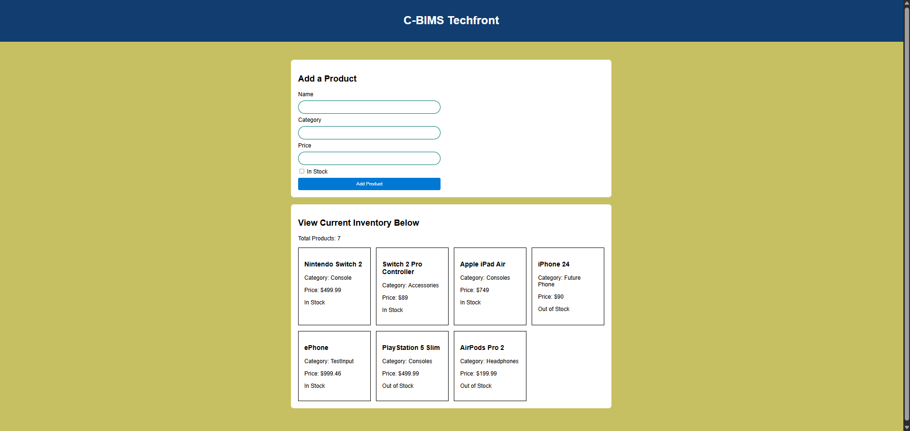
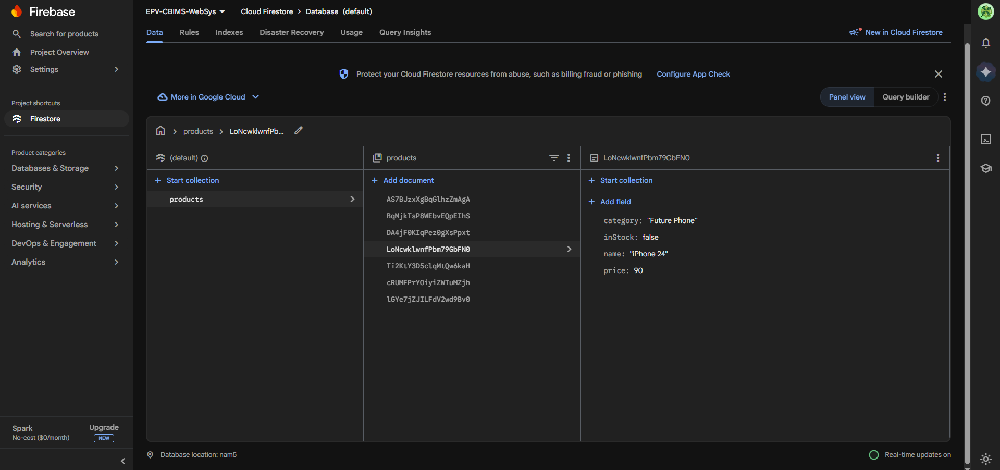
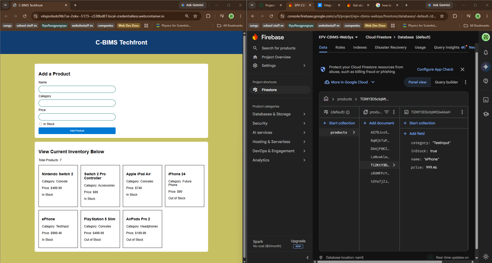

# C-BIMS Techfront

A cloud-based inventory management web app for a fictional electronics store, built with HTML, CSS, JavaScript, and Google Firebase (Cloud Firestore).

Utilized Firebase & Vite (Stackblitz) in Dev Environment.

**Live project:** [Open in StackBlitz](https://stackblitz.com/edit/vitejs-vite-ntmrxbt1)

## Features
- Inventory dashboard that loads all products from Firestore
- Product counter showing the total number of products
- Add Product form that saves new products to Firestore
- Input validation on the form
- Responsive layout for different screen sizes

## Built With
- HTML, CSS, JavaScript
- Vite
- Firebase Cloud Firestore

## Screenshots

### Inventory Dashboard

### Firestore Products Collection

### New Product on the Website and in Firestore

## Reflection

I did an electronics store front project because i just recently obtained a Nintendo switch 2.. electronics and parts are hot on my mind. It also just so happened that was one of the possible recommended prompts. Deciding on a very simple design was something that also seemed very easy.

Future implementations would for sure have to be utilizing different pages and being able to click the inventory items and view their listing and comparing prices across retailers. 
